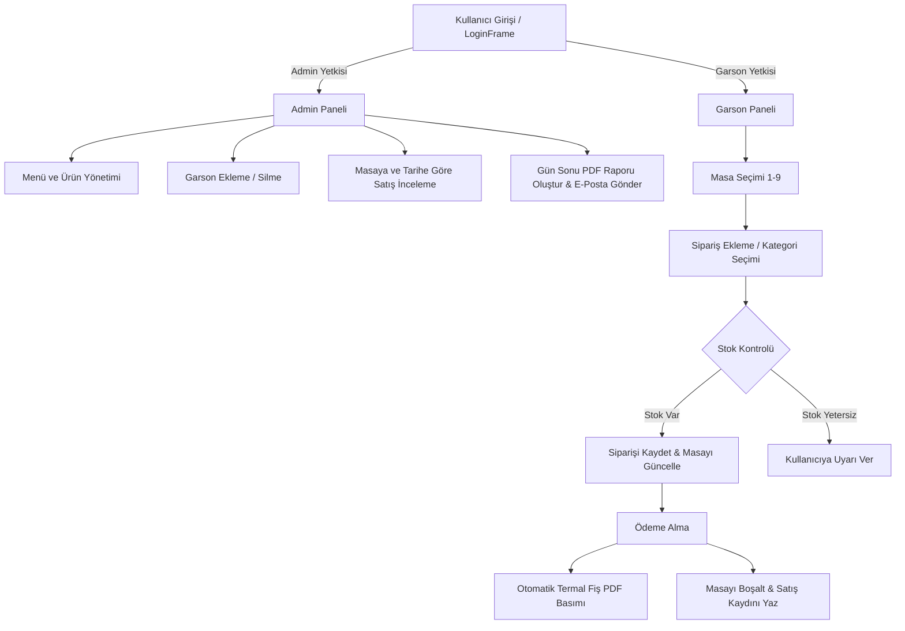

# 🍽️ UKA Restoran Yönetim Sistemi (Restaurant Management System)

> **Masaüstü Tabanlı, Rol Korumalı, PDF Raporlama ve E-Posta Entegrasyonlu Kapsamlı Restoran Otomasyonu**

[](https://openjdk.org/)
[](https://docs.oracle.com/en/java/javase/21/docs/api/java.desktop/javax/swing/package-summary.html)
[](https://itextpdf.com/)
[](https://eclipse-ee4j.github.io/mail/)
[](https://en.wikipedia.org/wiki/Flat-file_database)
[](LICENSE)

---

## 📌 Proje Özeti

**UKA Restoran Yönetim Sistemi**, modern restoran işletmelerinin sipariş takibini, masa doluluk oranlarını, stok durumunu ve personel yönetimini merkezi bir noktadan kolayca koordine etmelerini sağlayan, Java tabanlı masaüstü POS ve otomasyon çözümüdür. 

Sistem; rol tabanlı erişim kontrolü (Yönetici ve Garson), otomatik termal adisyon çıktısı, kapsamlı ciro analizleri, gün sonu PDF raporlaması ve raporların yetkililere anlık SMTP e-posta yoluyla iletilmesi gibi kritik operasyonel yeteneklerle donatılmıştır.

---

## ✨ Temel Özellikler (Key Features)

- 🔐 **Rol Tabanlı Kimlik Doğrulama & Yetkilendirme (RBAC):**
  - **Admin Paneli:** Menü yönetimi, personel (garson) kayıt/silme/güncelleme, masa ve geçmiş sipariş sorgulama, gün sonu raporları.
  - **Garson Paneli:** Masaların anlık durumlarını (Boş/Dolu) görselleme, sipariş alma, sipariş listeleme ve hesap kapatma.
- 🪑 **Etkileşimli Masa & Sipariş Yönetimi (POS):**
  - Masalara dinamik ürün ekleme, adet belirleme ve anlık sepet tutarı hesaplama.
  - Masa durumlarının sipariş akışına göre otomatik güncellenmesi.
- 📦 **Entegre Stok ve Ürün Havuzu Takibi:**
  - Kategoriye göre (Yemek, İçecek, Tatlı) ürün filtreleme.
  - Sipariş girildiğinde stok miktarının otomatik kontrolü ve düşülmesi; iptal veya iade senaryolarında stoğun geri yüklenmesi.
  - Geniş "Ürün Havuzu" üzerinden tek tıkla aktif menüye ürün transferi.
- 🧾 **Otomatik Termal Fiş / Adisyon Üretimi (PDF):**
  - Masa ödemesi tamamlandığında günlük artımlı fiş numarası (`YYYYMMDD-XXX`) üretimi.
  - Termal yazıcı standartlarına uyumlu (`80mm / Rectangle(226, 900)`) PDF formatında masaüstüne fiş dökümü.
- 📊 **Gün Sonu Raporlama & Otomatik E-Posta Gönderimi:**
  - Günlük toplam hasılat, ürün bazlı satış adetleri ve günün en çok satan ürün analizleri.
  - A4 formatında iText PDF rapor çıktısı.
  - Jakarta Mail (SMTP TLS) altyapısı ile oluşturulan raporun otomatik olarak işletme e-postasına ekli dosya olarak gönderilmesi.
- 📜 **Yönetici Denetim Kayıtları (Audit Logging):**
  - Admin panelinde gerçekleştirilen kritik işlemlerin zaman damgalı olarak `logs/admin_log.txt` kütüğüne işlenmesi.
- 🎨 **Modern ve Ergonomik Arayüz:**
  - Özel arka plan panelleri (`BackgroundPanel`), dinamik ızgara düzenleyicisi (`WrapLayout`), veri doğrulamalı giriş alanları (`NumericLimitFilter`, `CustomInputDialog`) ve görsel ürün kartları.

---

## 🏗️ Mimari ve Proje Yapısı

Proje, sorumlulukların ayrıştırıldığı katmanlı mimari (**Model-View-Controller / Service**) prensiplerine ve durum yönetimini kolaylaştıran **Singleton Pattern** yapısına uygun olarak tasarlanmıştır.

```
restaurant_management/
├── data/                         # Düz metin (Flat-file) veri depolama dizini
│   ├── fis_numaralari.txt        # Kesilen fişlerin sayaç ve geçmiş kayıtları
│   ├── kullanicilar.txt          # Sistem kullanıcıları, şifreleri ve rolleri
│   ├── masalar.txt               # Restoran masaları ve güncel durumları (BOS/DOLU)
│   ├── masa_siparisleri.txt      # Masalara ait aktif açık siparişler
│   ├── satislar.txt              # Gerçekleşen tüm geçmiş tahsilat hareketleri
│   ├── stok.txt                  # Ürünlerin anlık stok miktarları
│   ├── urunler.txt               # Aktif menüde satışta olan ürünler ve fiyatları
│   └── urun_havuzu.txt           # Menüye eklenebilecek hazır ürün kataloğu
├── fonts/                        # PDF belgelerinde Türkçe karakter desteği için fontlar
│   └── ARIAL.TTF                 # Arial TrueType fontu
├── icons/                        # Arayüz simgeleri ve ürün görsel kütüphanesi
├── logs/                         # İşlem ve denetim log kayıtları
│   └── admin_log.txt             # Admin hareket dökümü
├── src/                          # Java kaynak kodları
│   ├── application/              # Uygulama başlangıç noktası
│   │   └── Main.java             # main(String[] args) metodu
│   ├── controller/               # Sunum ve servis katmanı arasındaki kontrolcüler
│   │   ├── AdminController.java  # Yönetici işlem akış kontrolcüsü
│   │   ├── GarsonController.java # Garson akış kontrolcüsü
│   │   └── LoginController.java  # Kimlik doğrulama kontrolcüsü
│   ├── mail/                     # E-posta bildirim konfigürasyonu
│   │   └── mail.properties       # SMTP kimlik ve sunucu parametreleri
│   ├── model/                    # Temel iş modelleri / Varlık sınıfları
│   │   ├── Kullanici.java        # Kullanıcı (Admin/Garson) varlığı
│   │   ├── Masa.java             # Masa veri modeli
│   │   ├── OdenmisSiparis.java   # Satış kaydı modeli
│   │   ├── Siparis.java          # Masa siparişi varlığı
│   │   ├── StokYonetimi.java     # Stok takip modeli
│   │   └── Urun.java             # Ürün ve fiyatlandırma modeli
│   ├── servis/                   # İş mantığı ve veri erişim servisleri (Singleton)
│   │   ├── AdminLogServisi.java  # Olay günlüğü tutma servisi
│   │   ├── KullaniciServisi.java # Kullanıcı doğrulama ve personel yönetimi
│   │   ├── MasaServisi.java      # Masa durumu ve sipariş yükleme servisi
│   │   ├── OdenmisSiparisServisi.java # Ödenmiş siparişlerin filtrelenmesi
│   │   ├── SatisServisi.java     # Satış kayıtlarının dosyaya yazılması
│   │   ├── SiparisServisi.java   # Aktif sipariş operasyonları
│   │   ├── StokServisi.java      # Gerçek zamanlı stok artış/azalış servisi
│   │   └── UrunServisi.java      # Ürün katalog yönetimi
│   ├── view/                     # Swing ekranları (JFrames & JDialogs)
│   │   ├── LoginFrame.java       # Giriş ekranı
│   │   ├── AdminPanel.java       # Ana yönetici paneli
│   │   ├── GarsonPanel.java      # Masa izleme ve garson ana ekranı
│   │   ├── GunSonuRaporuFrame.java # PDF rapor & e-posta gönderim ekranı
│   │   ├── OdemeFrame.java       # Hesap kapatma ve fiş kesme ekranı
│   │   ├── SiparisEkleFrame.java # Ürün seçim ve sipariş verme ekranı
│   │   └── ...                   # Kategori, liste ve detay pencereleri
│   └── view_components/          # Tekrar kullanılabilir özel UI bileşenleri
│       ├── BackgroundPanel.java  # Arka plan görsel desteği
│       ├── MasaCard.java         # Masaları temsil eden özel kart bileşeni
│       ├── ProductCard.java      # Ürün görsel ve fiyat kartları
│       ├── WrapLayout.java       # Esnek akışlı yerleşim yöneticisi
│       └── NumericLimitFilter.java # Sayısal ve karakter limit filtreleri
├── .classpath                    # IDE derleme yolu ve kütüphane tanımları
├── .project                      # Eclipse proje tanımı
└── README.md                     # Proje dokümantasyonu
```

---

## 🛠️ Kullanılan Teknolojiler (Tech Stack)

| Alan | Teknoloji / Kütüphane | Versiyon | Açıklama |
| :--- | :--- | :--- | :--- |
| **Programlama Dili** | Java | 21 (LTS) | Temel programlama dili |
| **Kullanıcı Arayüzü (GUI)** | Java Swing / AWT | Yerleşik | Masaüstü grafiksel kullanıcı arayüzü |
| **Doküman & Fiş Üretimi** | iText PDF | 5.5.13.2 | Termal fiş ve gün sonu A4 PDF üretimi |
| **E-Posta Servisi** | Jakarta Mail | 2.0.1 | Raporların SMTP üzerinden iletimi |
| **Aktivasyon Altyapısı**| Jakarta Activation | 2.0.1 | Mail MIME çoklu parça veri yönetimi |
| **Veritabanı / Kalıcılık** | Flat-File (Düz Metin) | TXT Tabanlı | Noktalı virgül (`;`) ayrılmış dosya tabanlı veri depolama |
| **Tasarım Kalıpları** | Singleton, MVC | - | Mimari organizasyon |

---

## 🚀 Kurulum ve Çalıştırma (Getting Started)

### 📋 Ön Gereksinimler

- **Java Development Kit (JDK):** Sürüm 21 veya üzeri ([Oracle JDK](https://www.oracle.com/java/technologies/downloads/) veya [Eclipse Temurin](https://adoptium.net/)).
- **IDE (Önerilen):** Eclipse IDE for Java Developers, IntelliJ IDEA veya VS Code.
- **Git:** Sürüm kontrol aracı.

---

### 📥 Adım Adım Kurulum

1. **Depoyu Klonlayın:**
   ```bash
   git clone https://github.com/utkuberaozkan/restaurant_management.git
   cd restaurant_management
   ```

2. **Harici Bağımlılıkları (JAR Dosyaları) Temin Edin:**
   Projede kullanılan kütüphanelerin JAR dosyalarının projenin derleme yolunda (Build Path) bulunması gerekir:
   - `itextpdf-5.5.13.2.jar`
   - `jakarta.mail-2.0.1.jar`
   - `jakarta.activation-2.0.1.jar`

   > 💡 *Bu dosyaları projenizin kök dizininde bir `lib/` klasörü açarak içerisine yerleştirebilirsiniz.*

3. **IDE'ye Projeyi Dahil Edin:**
   - **Eclipse Kullanıcıları:** `File` > `Open Projects from File System...` seçeneğiyle klasörü seçin. Proje `.classpath` ve `.project` yapılandırmasını otomatik tanıyacaktır.
   - **IntelliJ IDEA Kullanıcıları:** `Open` diyerek klasörü seçin, `Project Structure` > `Libraries` kısmından yukarıdaki JAR dosyalarını ekleyin.

---

### ⚙️ Ortam ve Yapılandırma Bilgileri

Sistemdeki e-posta gönderim fonksiyonunun (Gün sonu rapor iletimi) çalışabilmesi için `src/mail/mail.properties` dosyasının konfigüre edilmesi gerekmektedir:

```properties
# src/mail/mail.properties
mail.username=restoran_eposta@gmail.com
mail.password=uygulama_ozel_sifresi
mail.to=yonetici_eposta@gmail.com
```

> [!IMPORTANT]
> Gmail üzerinden SMTP ile e-posta göndermek için normal hesap şifreniz yerine Google Hesabınızdan **İki Adımlı Doğrulama** açıp bir **"Uygulama Şifresi" (App Password)** üretmeniz gerekmektedir.

---

### 💻 Uygulamayı Başlatma

#### 1. IDE Üzerinden:
- `src/application/Main.java` dosyasını açın.
- `Run As` > `Java Application` seçeneğini tıklayın.

#### 2. Komut Satırı (CLI) Üzerinden:
```bash
# Sınıfları derleyin (Windows örneği)
javac -encoding UTF-8 -cp "lib/*;src" -d bin src/application/Main.java

# Uygulamayı çalıştırın
java -cp "bin;lib/*" application.Main
```

---

## 📖 Kullanım Senaryoları & Varsayılan Hesaplar

### 🔑 Varsayılan Giriş Bilgileri

Sistem `data/kullanicilar.txt` dosyası üzerinden kullanıcıları denetler. Test için kullanabileceğiniz hazır hesaplar:

| Kullanıcı Adı | Şifre | Rol | Yetki Kapsamı |
| :--- | :--- | :--- | :--- |
| `admin` | `1234` | **Admin** | Menü, Stok, Personel, Sorgulamalar, Raporlar |
| `utku` | `1234` | **Garson** | Masalar, Sipariş Alma/Düzenleme, Ödeme Tahsilatı |

---

### 🔄 İş Akışları (Workflow)



1. **Sipariş Alma Süreci:**
   - Garson oturum açtıktan sonra ilgili masayı seçer.
   - Kategorilerden (Yemek, İçecek, Tatlı) sipariş edilen ürünleri adediyle ekler.
   - Sistem `data/stok.txt` kontrolünü yaparak yeterli miktar varsa masaya siparişi işler ve stoğu düşürür.
2. **Ödeme & Fiş Kesim Süreci:**
   - Garson "Ödeme" butonuna basarak adisyonu inceler.
   - Onay verildiğinde; `data/fis_numaralari.txt` üzerinden sıralı numara çekilir, masaüstüne `Masa_X_Fis.pdf` üretilir, masa "BOŞ" durumuna getirilir ve satış geçmişe (`satislar.txt`) kaydedilir.
3. **Gün Sonu Kapanış Süreci:**
   - Yönetici "Gün Sonu Raporu" sekmesinden günü seçer.
   - Sistem o günkü tüm ciro ve ürün satış adetlerini hesaplar.
   - "PDF Al" butonuna tıklandığında `Gun_Sonu_Raporu_GG.AA.YYYY.pdf` dosyası üretilir ve yapılandırılan işletme e-posta adresine otomatik olarak gönderilir.

---

## 🧪 Test ve Katkıda Bulunma (Testing & Contributing)

### Testler
- Veri tutarlılığı testleri `data/` altındaki metin dosyalarının format bozulmalarına karşı incelenmesiyle yapılabilir.
- Arayüz akışları ve stok kilit mekanizmaları çoklu sipariş senaryoları ile doğrulanmıştır.

### Katkıda Bulunma Adımları
1. Bu depoyu çatallayın (Fork edin).
2. Yeni bir özellik veya hata onarımı için dal oluşturun (`git checkout -b feature/yeni-ozellik`).
3. Değişikliklerinizi commit edin (`git commit -m 'feat: Yeni masa transfer mekanizması eklendi'`).
4. Dalınıza push yapın (`git push origin feature/yeni-ozellik`).
5. Bir **Pull Request (PR)** açarak katkınızı sunun.

---

## 📄 Lisans

Bu proje [MIT Lisansı](LICENSE) kapsamında açık kaynak olarak lisanslanmıştır. Detaylar için `LICENSE` dosyasına başvurabilirsiniz.

---

<div align="center">
  <sub>Geliştirici: <b>Utku Bera Özkan ve Ekibi</b> • UKA Restoran Çözümleri</sub>
</div>
